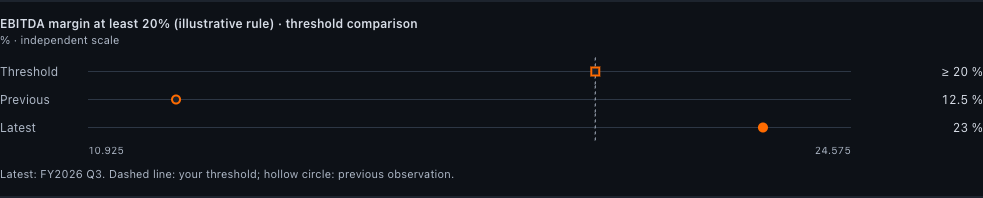
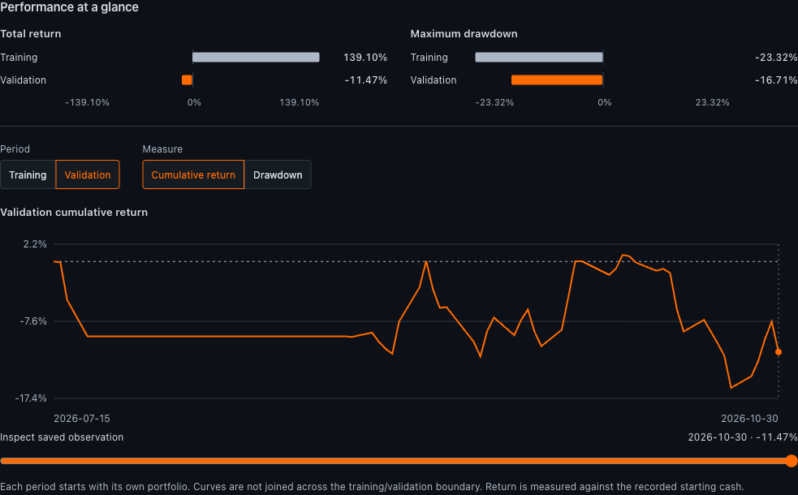

# OpenTerminalUI 0.9.0

Research that stays connected: move from a company thesis to sourced changes, scheduled discovery, earnings review and reproducible experiments.

## Highlights

- **Today inbox:** review thesis changes and screen entries/exits with source evidence, fiscal periods and before/after values. Review, snooze, reopen and undo persist per account.
- **Research dossiers:** measurable thesis conditions, dated observations, optional daily SEC/NSE filing ingestion, revision history, revocable sharing and evidence exports.
- **Scheduled screens:** daily/weekly checks, explicit data coverage and explanations for membership changes. Missing or stale data is never treated as an exit.
- **Earnings reviews:** preserve expectations and guidance, then compare sourced actuals without rewriting the original forecast.
- **Portfolio research:** inspect shared suppliers, customers, commodities and assumptions, with citations, holding-count/weight charts and a relationship matrix.
- **Visual analysis:** threshold plots, earnings guidance bands, screen metric comparisons, coverage meters and accessible, responsive charts.
- **Frozen experiments:** CSV readiness checks, exploratory and point-in-time modes, SMA/EMA/buy-and-hold strategies, return/drawdown curves, exports and deterministic replay.
- **Workspace and agent improvements:** recoverable agent runs, evidence exports, configurable layouts and company identities, including MTAR's verified official logo.

The screenshots show historical research and simulated experiment results, not current investment recommendations. The MTAR threshold is an illustrative research rule.

## Fixes

- Python script timeouts now terminate and reap a child worker instead of leaving a runaway thread and process-global output capture behind. The Windows launcher includes worker dispatch.
- Filing collection/parsing preserves numeric evidence and source citations.
- Screen deep links restore the saved query; evidence review and chart layouts work on mobile.
- The screener browser regression follows the current UI, and CI preserves the frontend test process exit status.
- Unknown observations, missing quotes and provider failures retain explicit coverage states rather than fabricated values.

## Upgrade notes

- Back up your database and apply Alembic through **0014_research_review** using your normal migration procedure. This adds review-state and scheduled-screen tables; dossier additions use versioned JSON payloads.
- Exact experiment replay checks the engine fingerprint. Experiments frozen by an older engine remain viewable/exportable, but exact replay requires that engine version. Create a new experiment to run them under 0.9.0.
- Experiments remain single-instrument. Point-in-time checks validate supplied availability/provenance; they do not independently audit a vendor or implement historical-universe selection.
- Source ingestion and screen refresh depend on configured providers and their limits. During MTAR validation, some live fundamentals were unavailable; historical filing evidence and downloaded price data were used with their provenance retained.
- Read the [research review workflow guide](https://github.com/Hitheshkaranth/OpenTerminalUI/blob/v0.9.0/docs/RESEARCH_REVIEW_WORKFLOWS.md) for configuration and boundaries.

## Validation

- Backend: 1,663 tests passed, 75.73% coverage.
- Frontend: 715 tests passed; TypeScript/Vite production build passed.
- Fresh migration through 0014 and desktop/mobile browser checks passed.
- Full configured Playwright suite: 38 passed, four mobile-only cases skipped by the Chromium-only CI configuration.
- MTAR exploratory replay matched with zero provider requests; unknown historical availability remained unverified.

Full changelog: https://github.com/Hitheshkaranth/OpenTerminalUI/compare/v0.8.0...v0.9.0
